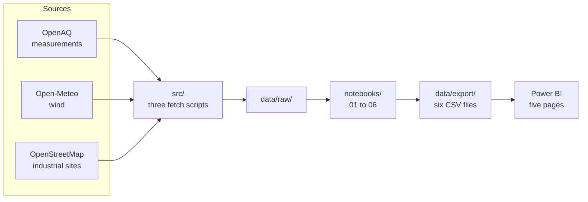
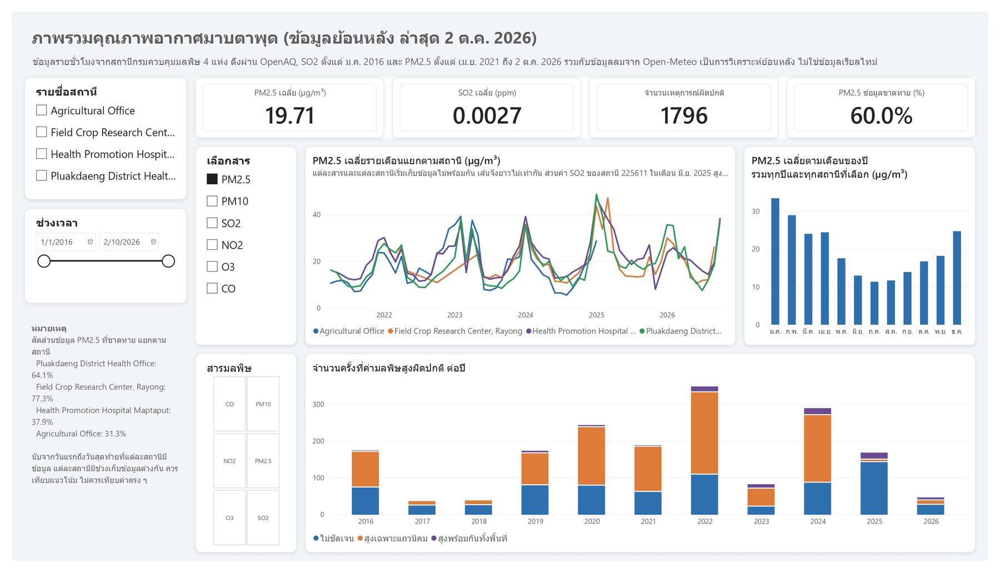
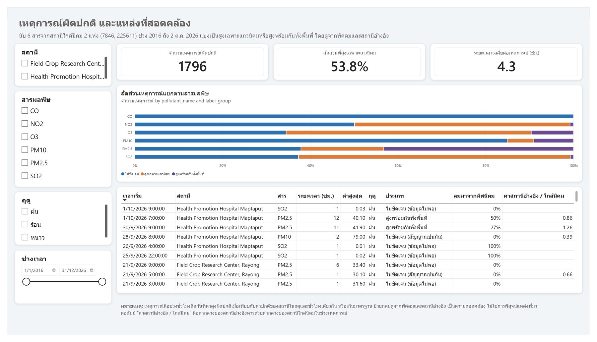
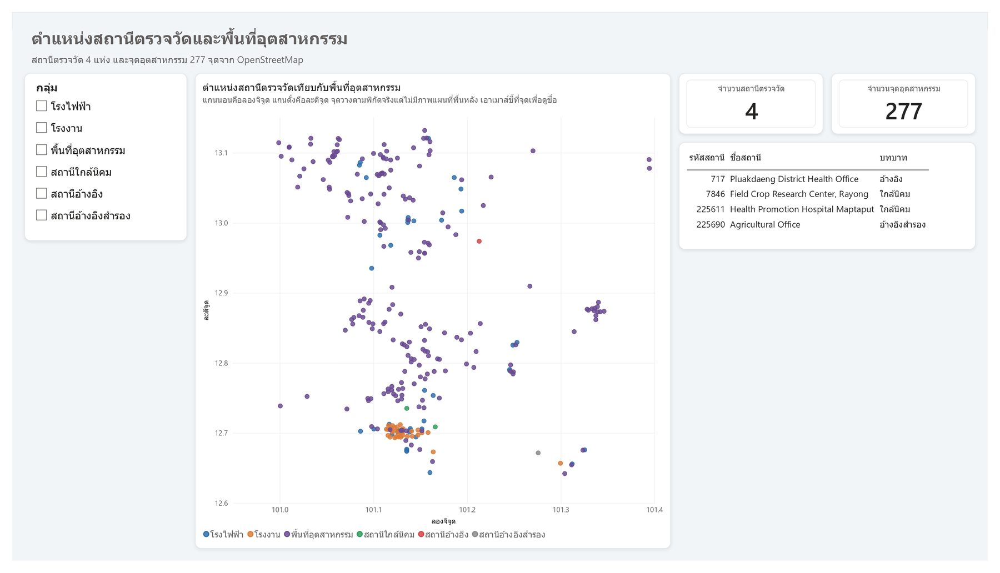

# Map Ta Phut Air Quality Monitoring (retrospective analysis)

    

> **This is a retrospective analysis, not a real-time system.** Data was pulled from OpenAQ, with the latest observations on 2 October 2026. There is no live alert system. The precision and recall figures reported below come from a back-test that asks: if the 24-hour-ahead forecasts had been used to issue warnings, how well would those warnings have performed?

## Results at a glance

| What was measured | Result |
|---|---|
| Episodes detected | 1,796 across six pollutants, at the two stations near the estate |
| Consistent with a local source | 62.0% of SO₂ episodes, against 0.8% regional |
| Consistent with regional pollution | 43.3% of PM2.5 episodes, the opposite pattern to SO₂ |
| 24-hour forecast | LightGBM 5.13 MAE against persistence 4.69, so the simple baseline wins |

## What this project asks

Map Ta Phut, Rayong, hosts one of Thailand's largest industrial estates. Air pollution readings there are sometimes high, and the same high reading could come from nearby sources or from haze affecting the whole region. This project asks three questions:

1. When do pollutant levels rise abnormally (episodes)?
2. Is each episode *consistent with* a local source or with regional pollution?
3. Can a model forecast PM2.5 and SO₂ 24 hours ahead better than a simple baseline?

Throughout, "consistent with" is used deliberately. The labels describe statistical agreement with wind direction and a reference station. They do not prove the cause of any episode, and no individual facility is identified.

## Pipeline



Nothing runs backwards, and every step after the three fetch scripts works offline.

## Data

### Stations

| Station ID | Name | Role | Distance from the estate centre |
|---|---|---|---|
| 225611 | Health Promotion Hospital Maptaput | Near the industrial estate | 4.5 km |
| 7846 | Field Crop Research Center, Rayong | Near the industrial estate | 5.8 km |
| 717 | Pluakdaeng District Health Office | Reference (main) | 33.4 km |
| 225690 | Agricultural Office | Reference (alternative, for checking only) | 13.7 km |

Distances are measured from the Map Ta Phut search point used to find the stations (12.6833, 101.1333 in `src/fetch_data.py`). Station to station, 225611 and 7846 are 4.4 km apart, and 225611 to 717 is 29.9 km.

### Coverage and missing data

Pollutants were not measured over the same periods. SO₂ at station 717 starts in January 2016, but PM2.5 only starts in April 2021, and February 2022 at station 7846. Other pollutants have shorter, patchier records. Missing data is counted from the first to the last day each station has data for that pollutant.

| Station | PM2.5 range | PM2.5 missing | SO₂ range | SO₂ missing |
|---|---|---|---|---|
| 717 | Apr 2021 to Oct 2026 | 29.4% | Jan 2016 to Dec 2024 | 38.9% |
| 7846 | Feb 2022 to Sep 2026 | 48.5% | Apr 2016 to Sep 2026 | 77.8% |
| 225611 | May 2021 to Oct 2026 | 37.9% | Apr 2021 to Oct 2026 | 55.1% |

Missing hours were never filled in. Where rows are needed on a regular hourly grid, as in the forecast, the gaps stay empty.

### Other inputs

- **Wind:** Open-Meteo, using ECMWF IFS (9 km grid) as the main source and ERA5 (25 km) as a fallback. These are model values, not measurements at the stations.
- **Industrial areas:** OpenStreetMap only, giving 277 sites (203 industrial areas, 40 power plants, 34 factories), of which 72 have names. The WRI power plant database was not used.
- **Standards:** thresholds come from the national ambient air quality standard of B.E. 2569.

### Quality checks

No negative or duplicate values were found. Sensor-stuck runs were **flagged, not removed**: 7,896 of 510,697 rows (1.55%) carry the flag. Notably, SO₂ at station 225611 jumps in June 2025 and stays high for almost the whole month. It was kept in the data and labelled `unverifiable`, because no other station measured SO₂ then and it cannot be confirmed.

## Methods

### 1. Detecting episodes

An hour is flagged when it meets **either** of two criteria:

- **Robust z-score ≥ 5**, computed per station, season and hour of day, so each station is compared against its own normal. The median absolute deviation is floored at the instrument resolution (0.001 ppm for gases), because 30% of SO₂ groups otherwise have a deviation of zero and the score would divide by zero. A threshold of 3 was rejected because it flags about 7% of all hours.
- **Above the national standard**, using the 1-hour limit for gases and the 24-hour rolling mean for PM2.5 and PM10, requiring at least 18 of 24 hours present.

Both are needed. For PM2.5, 4,445 hours exceed the standard while the z-score sees nothing, because dry-season haze is "normal" for that season at that station. Flagged hours that are consecutive at the same station and pollutant become one episode.

### 2. Local increment

The local increment is the near-estate reading minus the reference reading at the same hour. Hours when wind carries the estate into the reference station itself are excluded from the comparison.

### 3. Labelling each episode

Industrial directions were defined from OpenStreetMap geometry **before any pollution data was examined**: sectors were ranked by area weighted by 1/d², and the top sectors making up 80% of the weight were taken as the estate directions. Rules are applied in order, and the first match wins:

1. `unclear-no-data` if wind or reference coverage is below half the episode, or no increment is available
2. `regional` if the reference station reads at least half of the near-station value **and** the increment does not exceed the p75 threshold
3. `local-consistent` if wind comes from an estate direction for at least 60% of hours **and** the increment exceeds p75
4. `unclear-mixed` otherwise

The `regional` rule in step 2 was revised **after** seeing that the pre-registered version mislabelled events. The original results are kept for comparison, as described under Limitations.

### 4. Forecasting

The target is PM2.5 and SO₂ 24 hours ahead at station 225611. Every feature uses data at or before the issue time. The split is chronological and never random: training up to 30 June 2024, validation from July to December 2024, and test from 1 January 2025 onwards. Two baselines are required, `persistence` (the value 24 hours from now equals the current value) and `naive_week` (the value one week earlier).

## Results

### Episodes

1,796 episodes across six pollutants, from the two near-estate stations only.

| Pollutant | Episodes | Local-consistent | Regional | Unclear |
|---|---|---|---|---|
| SO₂ | 1,169 | 62.0% | 0.8% | 37.2% |
| O₃ | 279 | 55.9% | 9.7% | 34.4% |
| PM2.5 | 127 | 18.9% | 43.3% | 37.7% |
| NO₂ | 122 | 49.2% | 0.8% | 50.0% |
| CO | 66 | 0.0% | 0.0% | 100.0% |
| PM10 | 33 | 6.1% | 9.1% | 84.8% |

The split matches the physics without being told about it. SO₂ is overwhelmingly local-consistent and almost never regional, which fits a combustion gas with nearby sources. PM2.5 is the reverse. CO has no label at all because the reference station never measured CO.

Day 3 detects 2,451 episodes across all three main stations. The exported table holds the 1,796 that belong to the two near-estate stations, which are the ones the labelling rules can judge.

### Label names

| Notebook label | Dashboard label | Meaning |
|---|---|---|
| `local-consistent` | สูงเฉพาะแถวนิคม | High only near the estate |
| `regional` | สูงพร้อมกันทั้งพื้นที่ | High across the whole area at once |
| `unclear-mixed`, `unclear-no-data` | ไม่ชัดเจน | Mixed signals, or not enough data |

### Local increment, and why one number would mislead

Averaged over the whole record, the PM2.5 increment is **+3.17 µg/m³ at station 225611** but only **+0.03 µg/m³ at station 7846**. These must never be merged into a single figure. The monthly values at 225611 show why:

| Month | 225611 | Reference 717 | Difference | Hours compared |
|---|---|---|---|---|
| January 2025 | 47.0 | 46.1 | 0.9 | 353 |
| March 2025 | 37.8 | 24.4 | 13.4 | 609 |

In January both sites rise together, which is consistent with regional haze. In March the near-estate station stays high while the reference does not, which is consistent with a local excess. The January median increment is actually −3.9, so the small positive mean comes from a minority of hours rather than a steady offset.

### Forecast: the model does not beat the baseline

| Pollutant | persistence | naive_week | LightGBM |
|---|---|---|---|
| PM2.5 MAE (µg/m³) | **4.69** | 7.55 | 5.13 |
| SO₂ MAE (ppm) | **0.0065** | 0.0106 | 0.0186 |

LightGBM won on validation and lost on test. Three causes were found. The test period is unlike the training period, with a median PM2.5 of 21.95 against 18.00 and 666 SO₂ rows above 0.05 ppm against 32 in training. Most of the SO₂ loss falls inside the suspected sensor-drift window. The validation half-year contains no hot season. The model was **not** retuned afterwards, because tuning against a test set that has already been seen would make the result meaningless.

### Back-tested warnings

Treating a forecast at or above the threshold as a warning, over the test period:

| Pollutant | Method | Real exceedance hours | Warnings | Correct | Precision | Recall |
|---|---|---|---|---|---|---|
| PM2.5 | persistence | 673 | 622 | 427 | 0.686 | 0.634 |
| PM2.5 | LightGBM | 673 | 259 | 208 | 0.803 | 0.309 |
| SO₂ | persistence | 6 | 2 | 0 | 0.000 | 0.000 |
| SO₂ | LightGBM | 6 | 0 | 0 | n/a | 0.000 |

Neither method wins outright for PM2.5. LightGBM warns less often but is right more often when it does. SO₂ has only six real exceedance hours in the test set, far too few to conclude anything.

## Dashboard

A five-page Power BI report, `dashboard/maptaphut_air_quality.pbix`. **Screenshots and a walk-through of every page are in [docs/POWER_BI.md](docs/POWER_BI.md).**

<p align="center">
  <a href="docs/assets/dashboard-overview.jpg"></a>
  <a href="docs/assets/dashboard-episodes.jpg"></a>
  <a href="docs/assets/dashboard-map.jpg"></a>
</p>

| Page | Question it answers |
|---|---|
| ภาพรวม (Overview) | How do levels change over months and seasons? |
| เหตุการณ์ (Episodes) | Which pollutants look local, and which look regional? |
| พยากรณ์ (Forecast) | Does the model beat the baseline? |
| ทิศลม (Wind direction) | Which wind directions bring high readings? |
| แผนที่ (Map) | Where are the stations and industrial sites? |

Two visual choices were forced by the tool. Power BI has no built-in polar chart, so the wind page uses a 16-direction bar chart instead of a wind rose; a bar chart was preferred over a Python visual because it needs no add-in and responds to slicers. Azure Maps would not render on this machine, so the map page uses a scatter chart of longitude and latitude.

Power BI reads only the six CSV files in `data/export/` and runs no model of its own.

## Limitations

### The labels are associations, not causes

Wind agreement and a reference-station comparison cannot prove where pollution came from. Many facilities sit in the same direction. No facility is named as a source anywhere in this project.

### The reference station is not clean

Station 717 has **40.9 km² of industrial land within 10 km**, more than either near-estate station. The local increment is therefore an industrial area minus another industrial area, which understates it whenever wind carries the estate into 717. Hours like that are excluded, and a cleaner station, 225690 with 5.3 km², was used to check the result.

### PM2.5 labels depend on which reference station is used

Re-labelling against station 225690 gives the same answer for **SO₂ 100%** of the time and NO₂ 95.1%, but only **56.0% for PM2.5**, over the 445 episodes both can judge. PM2.5 episodes sit close to the threshold, so the label flips easily. **PM2.5 labels should be read as a tendency, not as a verdict on any single episode.** Station 225690 also only has data from April 2021 to January 2025.

### One rule was written after seeing results

Every rule was pre-registered except the final `regional` rule, which was revised after the pre-registered version proved faulty. It changed 3.0% of labels and, in practice, is decided by the increment condition rather than the ratio condition. Both versions are reported so the reader can judge.

### Validation checks, since there is no ground truth

| Check | Result |
|---|---|
| Threshold sensitivity | Labels unchanged across ratio 0.3 to 0.7; 1.9% change at p50, and 7.3 to 8.1% at p90 |
| Season, an independent check because season is not in the rules | PM2.5 `regional` is 55.9% in winter, 48.6% in the hot season and 15.2% in the rainy season, matching Thailand's haze season |
| Manual review of 15 episodes | 12 correct, 2 borderline, 1 doubtful |
| Changing the reference station | 92.4% agreement over 445 episodes |

### Data gaps

Missing data is heavy and was never imputed. **26% of PM2.5 hours (21,672) cannot be assessed against the 24-hour standard** because the window is under 75% complete, so the PM2.5 episode count is an undercount. Separately, gaps split single events in two, which inflates the count by about 2.3% (57 pairs). The longest unbroken stretch anywhere is 350 hours, which is why no sequence model such as an LSTM was attempted.

### Suspect sensor readings were labelled, not deleted

Seven episodes are marked `unverifiable`. The clearest is SO₂ at station 225611 in June 2025, which jumps from about 0.003 to about 0.077 ppm and stays there for most of the month, with no other station measuring SO₂ to check against. The rule only establishes that no other station was measuring, not that another station disagreed.

### Wind is modelled, not measured

Open-Meteo wind is a model grid, not an instrument at the station. Map Ta Phut is coastal, where the land and sea breeze reverses daily, and a 9 km grid may resolve that poorly. ERA5 at 25 km gives both near-estate stations identical wind because they are only 4.4 km apart, so it serves as a fallback only. `boundary_layer_height` was dropped because the API returned only the first 7 hours of each day, with implausible values.

### Forecast caveats

The validation half-year contains no hot season. Wind at the issue time is used rather than a wind forecast, and no hyperparameters were tuned. Results apply only to station 225611, one horizon, and the tested period.

### Other

Industrial locations come from OpenStreetMap alone, not the WRI database, and 205 of 277 sites are unnamed. The 1/d² weighting is a crude stand-in for dilution, not a dispersion model. The PM2.5 warning threshold of 37.5 µg/m³ is a 24-hour standard applied to hourly values, so it is a reference level rather than an exceedance. The SO₂ threshold of 0.1 ppm was confirmed from a secondary source and has not been checked against the original gazette text.

## Project structure

```
maptaphut-air-quality
├── README.md
├── requirements.txt
├── src
│   ├── fetch_data.py
│   ├── fetch_osm.py
│   └── fetch_wind.py
├── notebooks
│   ├── 01_data_check.ipynb
│   ├── 02_cleaning.ipynb
│   ├── 03_episodes.ipynb
│   ├── 04_attribution.ipynb
│   ├── 05_forecast.ipynb
│   └── 06_export.ipynb
├── data
│   ├── raw
│   ├── processed
│   └── export
├── reports
├── docs
│   ├── POWER_BI.md
│   └── assets
└── dashboard
    └── maptaphut_air_quality.pbix
```

`data/raw/` and `data/processed/` are rebuilt by running the pipeline, so they are not committed. The six files in `data/export/` are, which is why the dashboard opens without an API key. `reports/` holds the figures listed below, and `docs/assets/` the dashboard screenshots.

### What `data/export/` holds

| Exported file | Rows | One row is |
|---|---|---|
| `hourly.csv` | 151,093 | one station-hour |
| `episodes.csv` | 1,796 | one labelled episode |
| `forecast.csv` | 7,659 | one forecast hour for one pollutant |
| `plants.csv` | 277 | one industrial site |
| `wind_sectors.csv` | 64 | one station, pollutant and direction |
| `stations.csv` | 4 | one station |

## Reproducing this

Python 3.13 on Windows.

```bash
python -m venv .venv
.venv\Scripts\activate
pip install -r requirements.txt
```

An OpenAQ API key is required. Copy `.env.example` to `.env` and fill it in; `.env` is never committed. Then run the three scripts in `src/` and work through the notebooks in order. Notebook 06 writes the six CSV files that Power BI reads.

## Figures

| File | What it shows |
|---|---|
| `reports/example_episodes.png` | Four example episodes, including one regional and one local pattern |
| `reports/cpf_rose.png` | Conditional probability by wind direction, for SO₂ and PM2.5 |
| `reports/manual_check_1.png` to `_3.png` | The 15 episodes reviewed by eye |

## Credits

- Measurements: Thailand Pollution Control Department, accessed through **OpenAQ**
- Weather: **Open-Meteo** (ECMWF IFS and ERA5)
- Industrial locations: **OpenStreetMap** contributors, ODbL
- Standards: National Ambient Air Quality Standard, B.E. 2569

This is a personal portfolio project and is not affiliated with any agency or company. The tone is deliberately neutral: this is a sensitive subject for the community, and the analysis neither accuses nor defends anyone.
