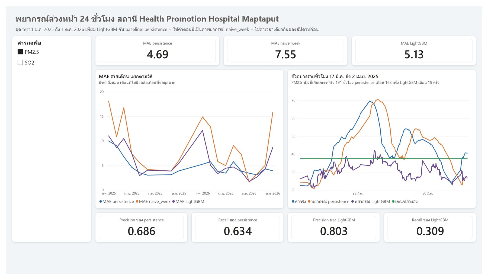
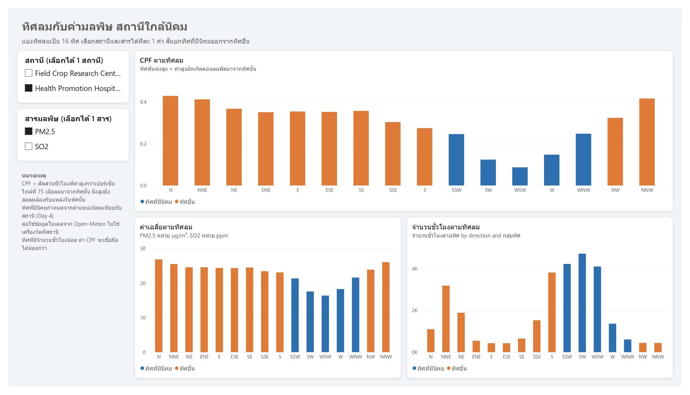

# Power BI

The report lives at [`dashboard/maptaphut_air_quality.pbix`](../dashboard/maptaphut_air_quality.pbix). Every page is shown below, captured from that file.

Power BI runs no model of its own. It reads the six CSV files in `data/export/`, which notebook 06 writes after the analysis is finished. The report is in Thai, because it is written for a Thai audience; the descriptions below are in English to match the rest of this repository.

## Data model

| From | To |
|---|---|
| `hourly[station_id]`, `episodes[station_id]`, `forecast[station_id]`, `wind_sectors[station_id]` | `stations[station_id]` |
| `hourly[date]`, `episodes[start_date]`, `forecast[date]` | `date[Date]` |

`date` is a DAX calculated table. Pollutant and wind columns are set to *Summarize by = None* so that every number on a page comes from an explicit measure rather than an accidental sum.

## Dashboard pages

### Overview

Four cards carry the headline numbers, followed by a monthly line per station and a bar chart of the same pollutant by calendar month. The pollutant selector on the left is a disconnected table, so one click re-titles and re-plots both charts. The seasonal shape is the point: January averages 33.5 µg/m³ against 11.4 in July. The fourth card reports 36.8% of PM2.5 hours missing, counted over each station's own PM2.5 period, and the note beneath the slicers breaks that figure down per station. The stations cover different periods, so their series are best compared by trend rather than level.

### Episodes

An episode is a run of consecutive hours that are abnormal for that station in that season and hour, or above the national standard. The 100% stacked bar shows how each pollutant divides between the three labels, and the pattern is the main finding of the project: SO₂ is mostly "high only near the estate" while PM2.5 is mostly "high across the whole area at once". The table below lists every episode with the evidence behind its label, namely the share of hours with wind from an estate direction and the reference-to-near ratio. The labels describe consistency, not proven causation.

### Forecast

PM2.5 and SO₂ forecast 24 hours ahead at station 225611, over the test period from 1 January 2025. Three cards compare mean absolute error for LightGBM and the two baselines, and **LightGBM loses to persistence** at 5.13 against 4.69 µg/m³. The monthly line chart shows where the gap opens up, and the hourly example from 17 March to 2 April 2025 shows the behaviour behind the precision and recall cards: persistence tracks the real curve one day late and raises 168 warnings, while LightGBM stays near the middle of the range and raises only 19. That is why LightGBM has the better precision, 0.803, and much worse recall, 0.309.

### Wind direction

Power BI has no built-in polar chart, so the wind rose is drawn as 16 direction bars; a bar chart was preferred over a Python visual because it needs no add-in and still responds to slicers. Blue marks the directions where industrial areas lie, defined from OpenStreetMap geometry before any pollution data was examined. Switching the pollutant selector tells the story: for SO₂ the blue bars are the tall ones, while for PM2.5, shown here, the tall bars are the other directions. The bottom right chart gives the hour count per direction, because a high probability computed from few hours means little.

### Map

Azure Maps would not render on this machine, so the page uses a scatter chart of longitude against latitude. There is no basemap behind the points, which is a real limitation, but the spatial relationship still reads clearly: the industrial areas form a band along the coast and up to the north, and the two near-estate stations sit inside the dense southern cluster, while reference station 717 sits in the northern cluster, which is why it is not a clean reference (see Limitations in the README).

## Conventions

- Time axes use `date[MonthStart]` on a continuous axis with straight line segments, never smoothed.
- Font sizes come only from `dashboard/maptaphut_theme.json`, not from individual visuals.
- Every page uses the same grid: a 320-wide slicer rail, content from x=360, and a 120-high card row.
- Card and chart titles state the unit and the scope, so a reader who has never seen the project can still read the number.

## Refresh

Re-run the notebooks in order. Notebook 06 rewrites the six CSV files in `data/export/`, and Power BI picks them up with *Home → Refresh*. Nothing in the report needs to be rebuilt by hand, because the model is wired to those file paths.
